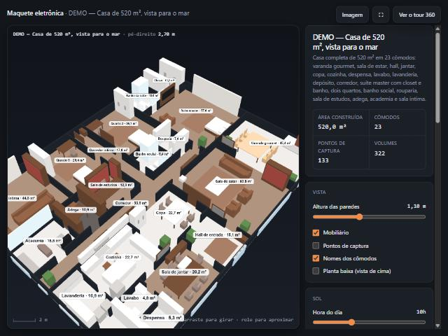
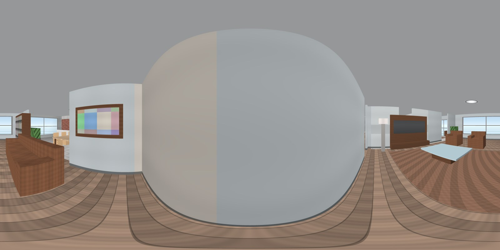
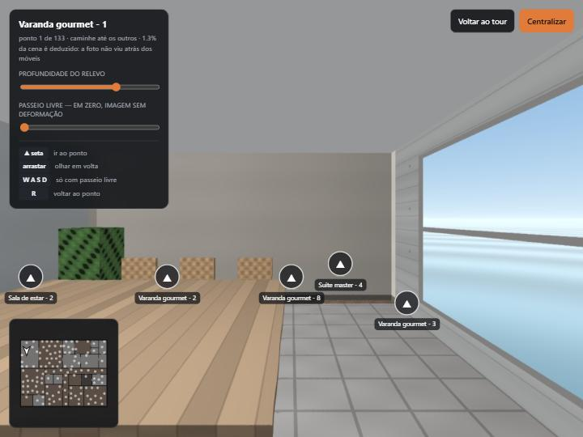

# Tour Virtual 360

Software que recebe fotos de um imóvel, costura em panorama 360° e publica um
tour navegável — com modo de caminhada em primeira pessoa, maquete eletrônica e
estimativa de metragem. O núcleo roda inteiro na máquina local, sem depender de
Kuula, CloudPano ou de API paga.

**Python 3.11 · Flask · OpenCV · ONNX Runtime · three.js**

## Como fica

Uma casa sintética de 520 m² em 23 cômodos, gerada por traçado de raios a
partir de uma planta em metros. Serve de demonstração e de banco de prova: a
profundidade dela é exata, então dá para medir o borrão da caminhada contra uma
verdade conhecida.

### A maquete eletrônica

O imóvel inteiro em 3D, com as áreas de cada cômodo e os pontos de captura.
Sai da mesma geometria que gerou os panoramas, em metros.



### O panorama 360

O que a costura entrega: equirretangular 2:1, aqui em 4096x2048. Esta saiu do
traçador; de fotos de celular, sai do `stitcher.py` pelo mesmo formato.



### Andar pelo ambiente

A caminhada em primeira pessoa, com as setas para os pontos vizinhos e a planta
no canto — a mesma planta da maquete, para quem anda não se perder.



## O que faz

- **Costura automática** de 8–12 fotos em panorama equirretangular (OpenCV), com
  5 configurações tentadas em ordem e validação do resultado — rejeita costura
  deformada em vez de entregar panorama inútil.
- **Várias formas de criar um ambiente:** costurar fotos, importar equirretangular
  pronto, converter panorama cilíndrico do celular, extrair quadros de um vídeo,
  importar um OBJ de escaneamento de celular ou gerar cena sintética de teste.
- **Modo de caminhada** com paralaxe real: a profundidade estimada transforma a
  casca do panorama em geometria, e os pontos de captura se encadeiam para
  percorrer o imóvel inteiro — inclusive **entre pavimentos**.
- **Maquete eletrônica** do imóvel em 3D, com as áreas de cada cômodo e os pontos
  de captura, vestindo as fotos do próprio imóvel.
- **Estimativa de metragem** a partir do mapa de profundidade, com publicação
  opcional no cartão do tour.
- **Correções automáticas:** nivelamento do horizonte pelas verticais da cena,
  reconstrução do teto, correção local de exposição (CLAHE) e marca no chão.
- **Panorama em ladrilhos**, para o visor baixar só o pedaço que está na tela.
- **Painel de administração** com setas de navegação, pontos de informação,
  miniaturas, dados do imóvel e cor de destaque.
- **Captura de lead** dentro do tour, com consentimento registrado, resposta por
  WhatsApp e exportação em CSV.
- **Multi-imóvel** com uma conta por imobiliária, isolamento por pasta e métricas
  de visita.
- **Exportação em ZIP:** site estático autocontido, que roda em qualquer
  hospedagem sem Python.

## Stack

| Camada | O que usa |
|---|---|
| **Backend** | Python 3.11 · Flask · Werkzeug · OpenCV · NumPy · ONNX Runtime · waitress |
| **Frontend** | JavaScript puro, sem framework e sem build · Pannellum · three.js (vendorizados) |
| **IA local** | Depth Anything V2 Small (94 MB) · LaMa (208 MB) — via ONNX, em CPU |
| **Infra** | Docker · Caddy 2 (HTTPS automático) · `unittest` da biblioteca padrão |

São poucas dependências de backend, e isso é escolha. Não há banco de dados, ORM
nem fila externa: os dados são JSON em disco com escrita atômica e trava por
imóvel, e a fila é uma thread. Num produto que uma imobiliária vai rodar por
anos, cada biblioteca a menos é uma atualização de segurança a menos para
acompanhar.

As bibliotecas de frontend são servidas localmente, não por CDN — o CDN estava
bloqueado no ambiente e o tour parava de funcionar. De quebra, o ZIP exportado
roda offline.

Os dois modelos de IA rodam na própria máquina: nenhuma chamada a API de
terceiros, nenhum custo por uso, e nenhuma foto de imóvel saindo do servidor — o
que também simplifica o lado da LGPD.

**Uma exceção, e ela é opcional:** o repintor de ambientes chama um modelo de
imagem no Replicate, que é serviço pago. Exige `REPLICATE_API_TOKEN` e é o único
ponto do projeto que fala com fora. Sem o token, todo o resto funciona.

**Tamanho:** 22.492 linhas de Python em 40 arquivos, 7.112 de HTML/JS/CSS em 7 páginas.

## Como rodar

```bash
git clone https://github.com/Jvsrp77/tour-virtual-360.git
cd tour-virtual-360
python -m pip install -r requirements.txt
```

Os modelos (302 MB) não vêm no repositório:

```bash
python baixar_modelo.py            # profundidade, 94 MB
python baixar_modelo.py --fundo    # reconstrução de fundo, 208 MB (opcional)
```

Sem eles tudo funciona, menos o modo de caminhada, a metragem e a camada de fundo.

```bash
python app.py         # desenvolvimento, porta 5000
python servidor.py    # produção, porta 8000, com backup automático
```

No Windows, dê dois cliques em `iniciar.bat` — o navegador abre sozinho no painel.

Abra **http://127.0.0.1:5000/imoveis**, que é o ponto de entrada. No primeiro
acesso a `/entrar` você cria a conta da sua imobiliária; o tour publicado
continua aberto a quem tem o link, e o login protege só o painel.

Para publicar em produção com HTTPS, ver [docs/operacao.md](docs/operacao.md).

## Vários imóveis

Cada imóvel é uma pasta isolada em `data/imoveis/<id>/`, com o próprio `tour.json`
e as próprias cenas. Dois imóveis nunca se misturam, e apagar um não toca no outro.

| Endereço | O que é |
|---|---|
| `/imoveis` | Lista, criar e excluir |
| `/painel/<id>` | Editor daquele imóvel |
| `/tour/<id>` | Link público para mandar ao cliente |
| `/andar/<id>` | Modo caminhar |

A API inteira vive sob `/api/imoveis/<id>/...`, num Blueprint do Flask que carrega
o imóvel no próprio caminho — nenhuma rota precisa recebê-lo como parâmetro.

Quem já tinha o formato antigo (um `data/tour.json` só) não perde nada: na
primeira subida o servidor migra sozinho para dentro de `data/imoveis/<id>/`.

## Documentação

| | |
|---|---|
| [**docs/decisoes.md**](docs/decisoes.md) | As decisões técnicas e os números que as sustentam |
| [**docs/operacao.md**](docs/operacao.md) | Produção, HTTPS, contas, backup, fila e tratamento dos leads |
| [**docs/captura.md**](docs/captura.md) | Como fotografar, captura em fileiras e correção de cenas antigas |

## Decisões de engenharia

O registro completo está em [docs/decisoes.md](docs/decisoes.md). Alguns exemplos:

- **Modelo de IA maior, testado e recusado.** O Depth Anything Base (389 MB, 4× os
  parâmetros) foi calibrado separadamente e medido contra o Small (94 MB). Ganho
  invisível no produto, chão *menos* nivelado (0,36° → 1,28°) e 2,5× o tempo.
  Terceiro modelo grande rejeitado por medição no projeto.
- **A técnica clássica ganhou da IA no teto — e perdeu atrás dos móveis.**
  Extrapolação de superfície marcou 2,6 de energia de cunha contra 37,3 do LaMa no
  polo. No mesmo projeto, o LaMa venceu o `cv2.inpaint` para reconstruir o que está
  atrás dos móveis. A rejeição era específica do caso, não veredito sobre o modelo.
- **Costura não determinística, consertada com uma linha.** A mesma captura dava 4
  panoramas distintos em 5 execuções, porque o RANSAC do OpenCV sorteia.
  `cv2.setRNGSeed()` levou a 5 de 5 idênticos, com custo zero — e destravou subir a
  resolução de 12,0 para 22,2 px/grau.
- **Abertura 91% mais leve.** Um esboço de 40 KB em perspectiva serve de pôster
  enquanto o panorama de 1,3 MB carrega: em 4G fraco, 7,1 s → 0,6 s até a primeira
  imagem.
- **Um defeito de concorrência que só aparecia no Windows.** O `MoveFileEx` recusa a
  troca atômica enquanto o destino tem handle aberto, e 1 de 40 contatos
  simultâneos se perdia. O teste existia e passava — mas só tinha escritores, e
  quem provoca o erro é o leitor.
- **A métrica que enganou duas vezes.** Energia de cunha mede quanto do anel foi
  coberto, não se o artefato saiu sem comer conteúdo. No polo, a imagem manda na
  métrica.

## Testes

```bash
python testes.py        # 475 testes em 38 classes
python mutacoes.py      # 157 mutações: confere se os testes não estão cegos
```

Rodam numa pasta descartável (`TOUR_DADOS`), nunca sobre os dados reais, e usam o
cliente de teste do Flask — não precisam de servidor no ar.

**Cada teste existe porque o defeito correspondente aconteceu de verdade** durante
o desenvolvimento, e só foi pego por verificação manual.

O `mutacoes.py` quebra cada proteção de propósito, uma por vez no arquivo real,
roda o teste que deveria pegar aquilo e desfaz a mudança. Se alguma linha disser
`NÃO ACUSOU`, o teste correspondente está decorativo.

Teste que passa em código quebrado é pior que teste nenhum — dá confiança sem dar
proteção. Detalhes em [docs/decisoes.md](docs/decisoes.md).

## Estrutura

```
app.py                    servidor Flask e API
servidor.py / servico.py  produção: waitress, backup automático, supervisão
stitcher.py               costura OpenCV e diagnóstico de falhas
profundidade.py           mapa de profundidade (Depth Anything V2, ONNX)
area.py                   metragem a partir da profundidade
nivelamento.py            horizonte, pelas verticais da cena
fundo.py                  camada atrás dos móveis (LaMa)
repintar.py               repintura de ambiente por vista
repintor_ia.py            a única parte que fala com fora (Replicate)
ladrilhos.py              corta o panorama para carregamento parcial
video.py                  escolhe os quadros de um vídeo que viram panorama
modelo3d.py               importa OBJ de escaneamento de celular
maquete3d.py              exporta a geometria para OBJ + MTL
plantas.py                as plantas dos imóveis sintéticos, como dado
cena_demo.py              gerador de cena 360 sintética
cena_apartamento.py       apartamento inteiro por traçado de raios
publicar.py               monta um imóvel a partir de planta renderizada
tarefas.py                fila de processamento
backup.py                 criar, listar e restaurar backups
conta.py / usuarios.py    contas de acesso ao painel
aviso.py                  avisa o corretor quando um contato chega
testes.py / mutacoes.py   suíte e teste dos testes
static/                   painel, visualizador, caminhada, maquete, captura
data/imoveis/<id>/        um imóvel: tour.json + scenes/
docs/                     documentação estendida
```

## Limitações conhecidas

- A costura roda em CPU e leva de 10 a 25 segundos por ambiente. Em produção isso
  vira fila.
- Fotos tiradas **andando** pelo cômodo (em vez de girar no eixo) não costuram —
  sem sobreposição não existe costura possível.
- Não faz reconstrução 3D a partir das fotos. O visitante olha em volta de pontos
  fixos e caminha ~1 metro a partir de cada um; para movimento livre seria
  Gaussian Splatting, que exige GPU e refotografar andando.
- **A metragem não está validada de forma geral.** O erro de +2,4% vale para a
  imagem aferida contra LiDAR; a conversão de disparidade para metros usa
  constantes ajustadas a uma única imagem. Cena corrigida fica marcada para
  revisão no painel.
- Atrás dos móveis não existe informação que a câmera tenha visto — a camada de
  fundo é conteúdo **gerado por IA**, declarado na tela ao visitante.
- **A repintura depende de serviço pago.** Sem `REPLICATE_API_TOKEN` o recurso fica
  indisponível; é o único ponto do projeto que não roda offline.
- Os leads ficam num arquivo JSON com trava por imóvel. Em produção com volume,
  banco de dados.
- As tarefas da fila vivem na memória do processo: reiniciar o servidor no meio de
  uma costura perde aquele trabalho.
- Escala só em uma máquina. As travas são `threading.RLock` e a fila é uma thread —
  crescer é mais thread e mais CPU, não mais processo.

## Licença

[MIT](LICENSE)
